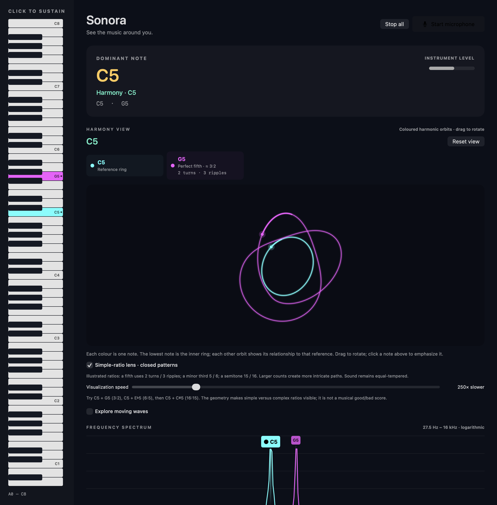
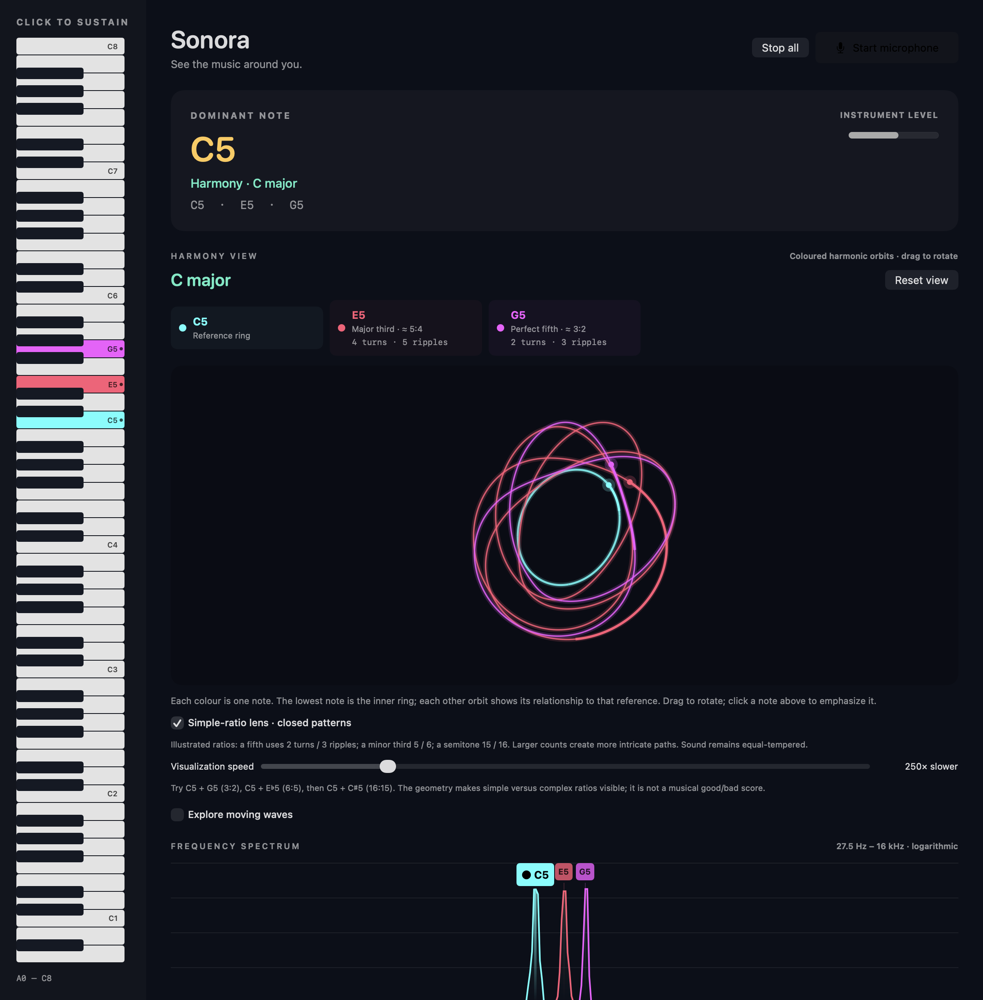

# Sonora

**Hear a chord. See its shape.**

Sonora is a native macOS playground for exploring notes, chords, and frequency relationships. Latch notes on a vertical piano, hear continuous tones, and compare their coloured orbits in a rotatable 3D view. Switch to the microphone to inspect sounds around you.

## Screenshots

### A perfect fifth — C5 and G5



### A major triad — C5, E5, and G5



Screenshots are rendered from the app’s actual interface with silent demonstration chords.

## Run

Requires macOS 13 or later and Apple's Command Line Tools. No third-party dependencies or Xcode project are needed.

```sh
xcode-select --install # only if the Command Line Tools are not already installed
./build.sh
open build/Sonora.app
```

You can drag the built app into Applications. The app is locally ad-hoc signed; this repository does not provide a notarized release.

## Explore

- **Click a piano key** to sustain a sine tone; click it again to release it.
- **Stop all** or **Escape** releases every note.
- **Drag the spatial view** to rotate it. Every note has a stable colour matching its key and spectrum marker.
- **Click a note card** to emphasize that orbit; click it again to restore all notes.
- **Visualization speed** changes the moving markers without changing audio pitch or playback speed.
- **Simple-ratio lens** draws clean, closed illustrations of nearby frequency ratios. Turn it off to view actual equal-tempered ratios.
- **Explore moving waves** reveals the optional stacked waveform view, alignment pulses, and combined wave.
- **Start microphone** switches to your default input. Allow access when prompted. Clicking a piano key switches back to the instrument.

Try C5 + G5 (approximately 3:2), C5 + E♭5 (6:5), then C5 + C♯5 (16:15). The orbit denominator determines turns around the reference and the numerator determines ripples: larger counts produce more intricate shapes. With several notes, each orbit describes its relationship to the lowest selected note.

These are illustrations of frequency relationships, not literal motion of sound through space or a universal good/bad harmony score. The audio always uses equal temperament, including when the ratio lens is enabled.

## Microphone analysis

The spectrum shows energy from 27.5 Hz to 16 kHz on a logarithmic axis. Detected notes highlight the A0–C8 keyboard, and the strongest detected note gets the main readout. Chord names are estimates from a small dictionary of common chord structures.

**Mic threshold** controls the minimum peak amplitude relative to the strongest peak (7–45%, default 18%). Lower it to include quieter chord tones; raise it to reject more noise and overtones. It affects detected notes, not the spectrum display.

Clear, sustained tones work best. Room noise, overtones, and microphone placement affect detection. Octave doubling and very low notes can be missed in microphone mode. Instrument mode uses the known selected notes for labels and analyses its output directly.

If access is denied, enable Sonora in System Settings → Privacy & Security → Microphone, then relaunch.

## Privacy

Microphone and instrument audio are processed locally. Sonora does not record audio, send audio to a server, or require an account.

## Development

| File | Purpose |
| --- | --- |
| `Sources/AudioAnalysis.swift` | Microphone input, sustained tone playback, FFT analysis, pitch extraction |
| `Sources/MusicTheory.swift` | Note names and chord naming |
| `Sources/Harmony.swift` | Interval ratios, chord explanations, alignment calculations |
| `Sources/PhaseSpace.swift` | Coloured 3D orbits, camera interaction, ratio lens |
| `Sources/ContentView.swift` | Keyboard, controls, spectrum, and optional wave views |
| `Sources/main.swift` | App lifecycle and executable checks |
| `Sources/ScreenshotExporter.swift` | Reproducible screenshots from silent demo chords |
| `build.sh` | Compile, assemble, and locally sign the app bundle |

Built with SwiftUI, AppKit, AVFoundation, and Accelerate. Analysis uses 8,192-sample Hann-windowed FFT frames, interpolated spectral peaks, harmonic filtering, and temporal smoothing. Generated tones use whole-cycle looping buffers.

### Checks

```sh
build/Sonora.app/Contents/MacOS/Sonora --self-test
build/Sonora.app/Contents/MacOS/Sonora --harmony-test
build/Sonora.app/Contents/MacOS/Sonora --instrument-test
```

The first two check generated-input detection, interval calculations, geometry, and alignment. The instrument check plays a brief chord and checks output analysis, toggling, stopping, and keyboard range; it requires audio output access.

Regenerate the screenshots from the built app:

```sh
build/Sonora.app/Contents/MacOS/Sonora --export-screenshots "$PWD/docs/screenshots"
```
